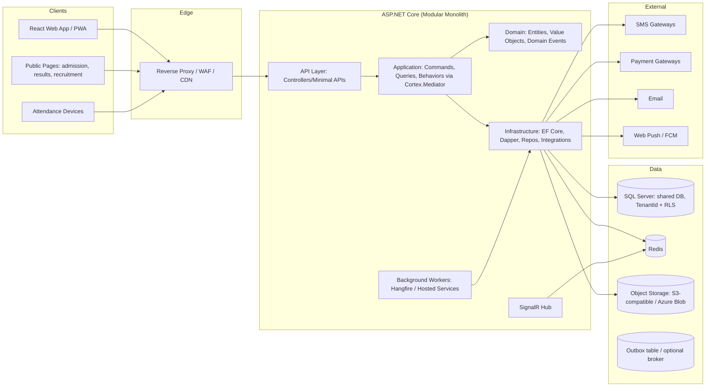
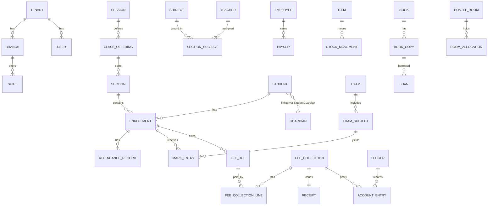

# Product Requirements Document (PRD)

## EximusEdu — Education Management System (EMS)

| | |
|---|---|
| **Document status** | Draft v1.0 for review |
| **Source** | `EximusEdu_Brochure_v3.pdf` (64 pages) and the Markdown conversion of it |
| **Date** | 18 November 2026 |
| **Audience** | Product, Architecture, Engineering, QA, DevOps, UI/UX |
| **Tech mandate** | C#, ASP.NET Core, React, SQL Server, Clean Architecture, CQRS, Repository Pattern, Cortex.Mediator |

> **How to read this document.** Sections 1–5 define *what* and *why*. Section 6 defines functional requirements per module with IDs and priorities. Sections 7–10 define *how* (architecture, data, API, UI/UX). Sections 11–15 cover quality, security, delivery and risk. Items marked **[ASSUMPTION]** are decisions I made where the brochure is silent; they are collected in §15 for your confirmation.

---

## Table of Contents

1. Executive Summary
2. Goals, Non-Goals and Success Metrics
3. Users and Personas
4. Product Scope and Phased Roadmap
5. Key Decisions (Confirmed and Assumed)
6. Functional Requirements (Modules M0–M12)
7. System Architecture
8. Data Architecture
9. API Design
10. UI/UX Design
11. Non-Functional Requirements
12. Security, Privacy and Compliance
13. DevOps, Observability and Operations
14. Testing and Quality Strategy
15. Risks, Assumptions and Open Questions
16. Appendices

---

## 1. Executive Summary

### 1.1 Problem

Schools, colleges, madrasahs, medical colleges and training centres in Bangladesh still run daily operations manually or across disconnected tools: roll-call attendance on paper, hand-marked exam scripts, cash fee collection with long queues, paper-based report cards, and accounts kept in ledgers. The brochure frames this as teachers spending their days on administration instead of improving student quality, and guardians having no visibility into attendance, results or dues.

### 1.2 Product vision

**One platform to run an entire educational institution** from admission to graduation, and from the principal's desk to the guardian's phone, available on web and mobile, in Bangla and English, with strong security and role-based control.

### 1.3 Product summary

EximusEdu is a **multi-tenant SaaS** Education Management System. It covers:

- **HR / people:** online admission, online recruitment, student/teacher/staff profiles, ID cards, certificates.
- **Attendance and leave:** manual, mobile and device-based (card, fingerprint, face, palm) attendance with automatic SMS and push notifications.
- **Academics:** exams, marks entry, one-click results, report cards, tabulation sheets, merit lists, admit cards, seat plans, class routines, lesson plans and evaluation, courses and assignments (Google-Classroom-like), online MCQ quizzes, class notes, syllabus.
- **Fees and accounts:** cash and online fee collection, receipts, dues, waivers, income/expense, ledgers, statements.
- **Other modules:** inventory, library, hostel, payroll and provident fund, donation, messaging and SMS, Hifz (Quran memorisation), administration.
- **Portals:** student/guardian panel and teacher panel.
- **Medical college features:** lecture/ward attendance with 75% rule, item-card-term exams, professional-exam eligibility, anonymous teacher evaluation.

The brochure states 150+ features and 200+ institutions as customers. This PRD describes a clean, modern re-architecture of that product on the mandated stack.

### 1.3.1 Brochure traceability

Every module in §6 cites the brochure parts (Part 1–8, appendix) it derives from. Appendix A holds the full traceability table.

---

## 2. Goals, Non-Goals and Success Metrics

### 2.1 Goals

| ID | Goal |
|---|---|
| G1 | Deliver every capability listed in the brochure through a single product, phased by value and dependency. |
| G2 | Meet or exceed the brochure's own promise that the product satisfies **90%+ of an institution's needs without customisation**, by making configuration (not code) the primary extension mechanism. |
| G3 | Provide **tenant isolation** strong enough for institutions such as military, medical and government-run schools. |
| G4 | Make daily teacher tasks (attendance, marks entry, lesson evaluation) **faster than paper**, measured by task time. |
| G5 | Give guardians real-time visibility (attendance, results, dues) and a frictionless online payment path. |
| G6 | Be **mobile-first** and usable on low-end Android devices and slow networks. |
| G7 | Be bilingual (Bangla/English) with correct Bengali typography, numerals and date formats. |
| G8 | Be secure by design: RBAC, full audit trail, and a regular VAPT cycle (the brochure markets this explicitly). |

### 2.2 Non-Goals (v1)

- A public marketplace or social features.
- Full LMS authoring (SCORM/xAPI, proctoring).
- A native mobile app on day one. A **PWA** ships first; the brochure's Android/iOS apps are a Phase 3 item (see §4).
- AI-based student analysis. The brochure mentions it as "coming soon"; it is Phase 4, behind a feature flag.
- ERP-grade general accounting (GL consolidation, tax filing). Accounts remain education-focused, as in the brochure.

### 2.3 Success metrics

| Metric | Target |
|---|---|
| Attendance recorded for a 40-student class | ≤ 30 seconds (teacher, mobile) |
| Result generation for a 1,000-student exam | ≤ 60 seconds, background job with progress |
| Guardian online fee payment | ≤ 4 taps from SMS/app open to confirmation |
| API p95 latency (read) | ≤ 300 ms; (write) ≤ 600 ms |
| Availability | 99.9% monthly |
| Tenant onboarding | ≤ 1 day for a standard school using import templates |
| Support tickets per 1,000 active users / month | Trending down quarter over quarter |
| Guardian monthly active usage | ≥ 40% of enrolled students' guardians by month 6 per tenant |

The brochure also reports (Part 8) a **30% rise in student attendance within three months** at one medical college after SMS notifications. We treat attendance uplift as a tracked product outcome.

---

## 3. Users and Personas

| Persona | Description | Primary needs | Primary device |
|---|---|---|---|
| **Institution Owner / Principal** | Oversees whole institution or group (e.g. Tanzimul Ummah with 125+ campuses). | Cross-campus dashboards, finance summary, approvals, trends. | Laptop, phone |
| **Accounts Officer** | Collects fees, enters expenses, closes ledgers. | Fast fee collection, correct receipts, daily vouchers, statements. | Desktop |
| **Admin / Office Staff** | Admissions, profiles, ID cards, certificates, routines. | Bulk operations, filters, print/export. | Desktop |
| **Class Teacher / Subject Teacher** | Attendance, marks, lesson plans, assignments, notes. | Speed, minimal clicks, works on phone. | Phone |
| **Exam Controller** | Exam setup, tabulation, merit list, publication. | Accuracy, locking, audit. | Desktop |
| **Student** | Views results, routine, notes; submits assignments; takes quizzes. | Clarity, mobile access. | Phone |
| **Guardian** | Monitors child; pays fees; reads notices; messages teachers. | Simplicity, trust, Bangla UI, push/SMS. | Phone (often low-end) |
| **Applicant (student/teacher)** | Applies online; pays application fee; downloads admit card. | Clear form, no login friction. | Phone |
| **Librarian / Hostel Warden / Store Keeper** | Module-specific operators. | Quick transactions, scanning. | Desktop |
| **Medical Dept. Coordinator** | Ward/lecture attendance, card-item exams, proff eligibility. | Eligibility reports, 75% rule enforcement. | Desktop |
| **Tenant Super Admin** | Configures roles, branches, academic structure. | Safe configuration, audit. | Desktop |
| **Platform Operator (Eximus staff)** | Onboards tenants, supports, monitors. | Impersonation (audited), health, billing. | Desktop |

### 3.1 Institution types supported

School (Bangla medium, English version, English medium), college, degree college, vocational/technical, pre-school/kindergarten, Islamic school, Madrasah (Alia and Qawmi), military institute, medical college, academic-care/training centre, MPO-listed institution, and non-education organisations such as a real-estate firm (the brochure lists one as a customer for HR/payroll/accounts use). Each type is a **tenant configuration profile** (§6, M0) rather than a code fork.

---

## 4. Product Scope and Phased Roadmap

### 4.1 Prioritisation

MoSCoW per requirement: **M** Must, **S** Should, **C** Could, **W** Won't (this release).

### 4.2 Phases

| Phase | Theme | Modules | Indicative duration* |
|---|---|---|---|
| **0 — Foundation** | Platform skeleton | M0 Platform, Tenancy, Identity, Audit, i18n, Notifications core, File storage, CI/CD | 8–10 weeks |
| **1 — Core operations (MVP)** | Replace paper for daily work | M1 People & Admission, M2 Attendance & Leave, M4 Exams & Results, M6 Fees, M7 Accounts, Guardian/Student/Teacher panels (core), M10 Messaging/SMS (core) | 16–20 weeks |
| **2 — Academic depth** | Teaching and learning | M3 Academic Planning (routine, lesson plan, diary, monthly report), M5 Courses/Assignments/Quizzes/Notes/Syllabus, Certificates, ID cards designer, Payroll, Donation | 14–18 weeks |
| **3 — Operations and reach** | Everything else | Inventory, Library, Hostel, Hifz, Committees, Medical College pack, Device integrations, PWA hardening, Native apps | 14–18 weeks |
| **4 — Intelligence** | Insight | AI student insights, predictive dropout/risk, analytics warehouse | TBD |

\*Durations assume a team of ~8–10 (see §13.5) and are planning estimates only.

### 4.3 Release strategy

- Tenants adopt **module by module** via feature flags and plan entitlements.
- Early adopters are migrated first; migration tooling for existing EximusEdu customers is a Phase 1 Should (see M0-24).
- Every phase ends in a production-ready, demonstrable increment.

---

## 5. Key Decisions (Confirmed and Assumed)

### 5.1 Confirmed by stakeholder

| # | Decision |
|---|---|
| D1 | **Tenancy:** multi-tenant SaaS, **single shared SQL Server database with `TenantId` on every tenant-owned row.** |
| D2 | **Scope:** full product, all 8 brochure parts, delivered in phases. |
| D3 | **Language:** UI is **bilingual, Bangla and English, user-switchable**, with per-user and per-tenant defaults. |
| D4 | **Stack:** C#, ASP.NET Core, React, SQL Server, Clean Architecture, CQRS, Repository Pattern, **Cortex.Mediator**. |

### 5.2 Implications of D1 (shared database)

- Isolation is enforced in **three layers**: (a) EF Core global query filters, (b) SQL Server **Row-Level Security (RLS)** as defence in depth, (c) automated tests that fail the build if any tenant-owned entity lacks a `TenantId`.
- Noisy-neighbour risk is managed with query timeouts, per-tenant rate limits, and a documented path to **move a large tenant to a dedicated database** (see §8.6). The design keeps this option open without changing application code.
- Backups are per database; **tenant-level restore** requires an export/restore tool (see M0-22).
- Indexes lead with `TenantId` (or are filtered per tenant) to keep plans stable.

### 5.3 Assumptions requiring confirmation

See §15.2.

---

## 6. Functional Requirements

**Conventions**

- IDs: `M<n>-<nn>`. Priority: M/S/C/W. Phase: P0–P4.
- "Branch" = campus. "Shift" = Morning/Day/Evening. "Version" = Bangla/English version. "Medium" = Bangla/English/Arabic. These are first-class academic-structure concepts, visible throughout the brochure's screens.
- Every list view supports search, filters, sorting, pagination, column chooser, and export (Print / PDF / Excel / CSV) unless noted. The brochure's tables consistently provide Print, PDF, Excel, Columns and Reset controls.
- Every mutation is audited (who, what, when, before/after) and permission-checked.

---

### M0 — Platform, Tenancy, Identity and Administration

*Brochure: Part 1 (security, VAPT, roles), Part 5 "Administrative management", cover pages.*

| ID | Requirement | Pri | Ph |
|---|---|---|---|
| M0-01 | **Tenant lifecycle:** create, configure, suspend, reactivate, archive tenants; assign plan and module entitlements. | M | P0 |
| M0-02 | **Tenant resolution** by sub-domain (`school.eximusedu.com`) and optional custom domain; fallback by `X-Tenant` header for API clients. | M | P0 |
| M0-03 | **Institution profile:** name (Bangla/English), logo, address, EIIN, school/college code, contact, website, principal signature image, tagline. Used on receipts, ID cards, report cards, admit cards. | M | P0 |
| M0-04 | **Academic structure:** Branch → Shift → Medium/Version → Class → Group → Section; Sessions (academic years); Semesters/Terms; Subjects (with codes, full marks, pass marks, components, optional/4th subject flags). | M | P0 |
| M0-05 | **Institution-type profiles** (school, madrasah, medical college, etc.) that pre-seed terminology, grading schemes, modules and sample templates. | S | P1 |
| M0-06 | **Authentication:** email/phone + password; OTP via SMS for first login and reset; refresh-token rotation; optional TOTP 2FA for staff. | M | P0 |
| M0-07 | **Bulk credential provisioning:** reset one user's password and SMS login details; bulk-set passwords for all students/teachers and SMS or print a distribution sheet (brochure: "Bulk Passwords Management"). | M | P1 |
| M0-08 | **Roles and permissions:** permission-based RBAC per **Module × Action** (View, Add, Edit, Delete + special actions such as Reset Password, Send SMS, Impersonate, View Application Logs). Roles are tenant-configurable; system roles are protected. | M | P0 |
| M0-09 | **Row/Scope-based access:** scope a user to branch(es), shift(s), class(es) or section(s). A class teacher sees only own sections. | M | P0 |
| M0-10 | **Audit trail:** immutable log of every create/update/delete/login/export/impersonation; filterable viewer; retained ≥ 7 years configurable. | M | P0 |
| M0-11 | **Application activity log** viewer for admins (brochure: "View Application Logs"). | S | P1 |
| M0-12 | **Impersonation** by platform operator or authorised admin, with reason capture, banner, time limit, audit. | S | P1 |
| M0-13 | **Notices** (publish to audience by role/class/branch; attachments; scheduled publish; read receipts). | M | P1 |
| M0-14 | **Events** calendar (holidays, exams, programmes) feeding dashboards and the academic calendar. | M | P1 |
| M0-15 | **Committees** (create, members, roles, dates). | C | P3 |
| M0-16 | **Guardian feedback/complaint box:** guardians submit; admin views and replies; status tracking. | S | P2 |
| M0-17 | **Custom forms and custom reports** builder (tenant-defined fields and simple report definitions). | C | P3 |
| M0-18 | **Templates:** SMS, email, notice, certificate, ID card, report card, admit card templates with variables (see M10-03). | M | P1 |
| M0-19 | **Settings:** grading scale, rounding, attendance rules (late cut-off, absent rule), fee rules, SMS sender IDs, payment gateway credentials (encrypted), working-day calendar. | M | P1 |
| M0-20 | **Feature flags and plan entitlements** enforced in API and UI. | M | P0 |
| M0-21 | **Import/Export:** Excel/CSV templates with validation and error report for students, teachers, subjects, fees, opening balances. | M | P1 |
| M0-22 | **Tenant data export/restore tool** (support and exit scenarios, and tenant-level restore from backup). | S | P2 |
| M0-23 | **Platform back-office** (Eximus staff): tenant directory, usage, SMS balance, billing, support tickets, health. | S | P2 |
| M0-24 | **Legacy migration tooling** for existing EximusEdu customers. | S | P1 |
| M0-25 | **In-app help and tutorials**; support-ticket entry and link to real-time call support. | C | P2 |

---

### M1 — People: Admission, Recruitment, Profiles, ID Cards, Certificates

*Brochure: Part 2 (pp. 5–10, 19–22).*

#### M1.A Student online admission

| ID | Requirement | Pri | Ph |
|---|---|---|---|
| M1-01 | Public, tenant-branded **online application form** (student, family, contact, previous institute, academic records, declaration); mobile-friendly; photo upload; configurable fields per institution. | M | P1 |
| M1-02 | **Application fee payment** online (gateways §9.6) or offline with verification; payment state shown as *Verified/Pending*. | M | P1 |
| M1-03 | On submission generate **application form PDF** with QR code and serial number. | M | P1 |
| M1-04 | On verified payment generate **admission-test admit card** (ID, applied-on, branch, class, session, exam schedule, contact numbers). | M | P1 |
| M1-05 | **Admin applications list:** filters (status, session, class, shift, group, gender, religion, application ID); statuses (Applied, Paid, Selected, Admitted, Rejected, Waitlisted); bulk actions. | M | P1 |
| M1-06 | **Application detail** page; download full application; "Admit" converts to a student record, assigning ID, roll, section; bulk admit; bulk update from Excel. | M | P1 |
| M1-07 | Admission-test marks/result entry and merit-based selection (could reuse M4). | C | P2 |

#### M1.B Teacher/staff online recruitment

| ID | Requirement | Pri | Ph |
|---|---|---|---|
| M1-10 | Public **recruitment form** per vacancy (post applied, personal, family, contact, academic records with certificate upload, employment history, trainings, declaration). | M | P2 |
| M1-11 | Application fee, application PDF, and **recruitment-exam admit card** (exam centre, date/time, signatures). | M | P2 |
| M1-12 | Admin list and detail of applications; shortlist, mark, select, convert to employee. | M | P2 |

#### M1.C Profiles

| ID | Requirement | Pri | Ph |
|---|---|---|---|
| M1-20 | **Student profile:** photo, IDs, enrolment (session, branch, shift, class, section, roll, group), personal data (DOB, blood group, height, weight, religion, nationality, birth-reg no.), father/mother/guardian with NID, occupation, income, emergency contacts, previous institute, residential/coaching status, guide/parent teacher, tags, subjects, admission info, attendance-device IDs (card/badge numbers). | M | P1 |
| M1-21 | **Student list** with the rich filter set shown in the brochure and actions (Admit, Bulk Admit, Bulk Update, Bulk Photo Upload, Summary, Admissions Summary). | M | P1 |
| M1-22 | **Tabbed student profile:** Dashboard, Profile, Fees, Results, Attendance, Class Routine, Exam Schedule, Inventory, Entitlements. | M | P1 |
| M1-23 | **Profile download** as branded PDF with QR code (student and teacher variants). | M | P1 |
| M1-24 | **Teacher/staff profile:** personal, family, education, experience, publications, extracurricular, administration (designation, contract, joining, nominee, PF), documents. | M | P1 |
| M1-25 | **Siblings link**, guardian account linkage (one guardian ↔ many students), transfer in/out, promotion to next class/session (bulk), status lifecycle (Active, Inactive, Transferred, Graduated, Dropped). | M | P1 |
| M1-26 | **Tags** on people (e.g. "Scholarship", "Defence quota") usable as report filters. | S | P2 |

#### M1.D ID cards

| ID | Requirement | Pri | Ph |
|---|---|---|---|
| M1-30 | **ID card designer:** drag-and-drop template with dynamic fields (name, ID, class, roll, blood group, photo, QR/barcode, signature); portrait/landscape; front and back; per-institution, per-campus, per-class designs; separate staff designs. | S | P2 |
| M1-31 | **Bulk generation and print/PDF** at standard card sizes, with print-bleed options. | S | P2 |
| M1-32 | Card number/biometric ID mapping fields for attendance devices. | M | P1 |

#### M1.E Certificates

| ID | Requirement | Pri | Ph |
|---|---|---|---|
| M1-40 | **Certificate templates** (Transfer certificate/ছাড়পত্র, Testimonial/প্রত্যয়নপত্র, Course completion, Character, custom) with variables, borders, seals, signatures. | S | P2 |
| M1-41 | **Issue, number, record and re-print** certificates; QR-based public verification page. | S | P2 |

---

### M2 — Attendance and Leave

*Brochure: Part 2 (pp. 11–19), Part 8 (pp. 79–80).*

| ID | Requirement | Pri | Ph |
|---|---|---|---|
| M2-01 | **Manual roll-call by teacher (web/mobile):** choose session, branch, shift, class, section, date; per-student Present/Absent/Late/Leave/Early-leave; "mark all present"; photo thumbnails; holiday warning. | M | P1 |
| M2-02 | **Device-based attendance** (card, fingerprint, face, palm; e.g. ZKTeco): ingestion via device push/ADMS, SDK gateway, or CSV; device registration per branch; mapping of device user IDs to people; de-duplication; offline buffering. | S | P3 |
| M2-03 | **Late/absent rules:** configurable cut-off times per shift/class/staff group, grace periods, half-day, working-day calendar. | M | P1 |
| M2-04 | **Staff attendance** with in/out times, totals, lateness; dashboards. | M | P1 |
| M2-05 | **Automatic notifications:** SMS to guardians for Absent/Late/Arrived (with arrival time); push/in-app to staff for Absent/Late/On-time. Templates in M0-18; per-event on/off. | M | P1 |
| M2-06 | **Reports:** student (whole institution, class, section) with summary chart and detailed day-by-day grid including totals and %; staff report; filters by branch/shift; Print/PDF/Excel. | M | P1 |
| M2-07 | **Attendance feeds** result cards (days held/present/absent) and payroll deductions (see M4, M9). | M | P1 |
| M2-08 | **Corrections** with reason, permission, and audit; lock after cut-off date. | M | P1 |
| M2-09 | **Leave types and balances** (casual, medical, etc.) per staff group; configurable accrual. | M | P1 |
| M2-10 | **Leave application workflow:** student/guardian or staff applies with attachment; multi-step recommend/forward/approve/reject with comments; calendar impact; balance deduction; admin queue with filters (session, branch, shift, class, section, roll, status, dates). | M | P1 |
| M2-11 | **Leave reports** per person and aggregate. | S | P2 |
| M2-12 | **Medical-college attendance** (see M12): per class type (lecture, tutorial, ward), per ward group, topic, per-subject totals, 75% eligibility, warnings. | M | P3 |

---

### M3 — Academic Planning: Routine, Lessons, Diary, Monthly Reports

*Brochure: Part 3 (pp. 37–44).*

| ID | Requirement | Pri | Ph |
|---|---|---|---|
| M3-01 | **Period and routine builder:** periods per shift with timings and breaks; assign subject + teacher + room per day/period; **clash detection** (teacher, room, section). | M | P2 |
| M3-02 | **Routine views:** per section (students), per teacher, all classes at a glance, all teachers weekly, all teachers by day; printable; weekly class-count summary per teacher. | M | P2 |
| M3-03 | **Daily lesson plan:** class work and home work per subject/section/date. | M | P2 |
| M3-04 | **Lesson evaluation:** per student per subject per day — *Learned / Partially learned / Didn't learn / Absent* and *Concentration (Excellent/Satisfactory/Needs improvement)*; quick-entry grid. | M | P2 |
| M3-05 | **Daily diary:** subject-wise evaluation summary and "lessons for next day"; visible to guardians. | M | P2 |
| M3-06 | **Monthly academic report** per subject per student: working days, classes, exams, learned/not-learned counts, exam marks and average, concentration counts, median/avg/min/max. | S | P2 |
| M3-07 | **Academic calendar** combining holidays, exams, events. | M | P2 |
| M3-08 | **Substitute teacher** assignment when a teacher is absent; notify. | C | P3 |

---

### M4 — Examinations, Results and Reports

*Brochure: Part 3 (pp. 23–36), Part 8 (pp. 81–83).*

#### M4.A Exam setup and marks

| ID | Requirement | Pri | Ph |
|---|---|---|---|
| M4-01 | **Exam configuration:** exam types (Class Test, Monthly Test, Home Work, Continuous assessment, Semester, Half-Yearly, Annual, Model Test); per-subject components (Sub/Obj/Practical/Viva/CA); full/pass marks per component; schedule (date, time, room). | M | P1 |
| M4-02 | **Result calculation rules (configurable per tenant/class):** weight of CT/MT/HW/continuous marks into semester total (e.g. CT 10%, MT 15%, final 75%); weights of semesters into annual result (e.g. 25/25/50); grade table (marks range → letter → point → comment); GPA with/without 4th subject; **merge two subjects** (e.g. Bangla 1st+2nd) for pass/fail and GP; **fail marking** per component; **extra subjects** excluded from total. | M | P1 |
| M4-03 | **Marks entry grid** for teachers (by exam, subject, section) with keyboard navigation, absent flag, validation against full marks, draft/submit, lock after deadline; Excel import/export blank sheet. | M | P1 |
| M4-04 | **Marks entry by admin/exam controller** with override and audit. | M | P1 |
| M4-05 | **Special evaluation and teacher's comments** per student per term. | M | P1 |
| M4-06 | **Auto signature insertion** (class teacher, head, controller, guardian line) from stored images. | S | P1 |
| M4-07 | **Merit/position calculation:** section position and class position by GPA then total marks with configurable tie-break rules. | M | P1 |

#### M4.B Outputs

| ID | Requirement | Pri | Ph |
|---|---|---|---|
| M4-10 | **Report card / transcript** (fully customisable layout): student info, grade table, per-term components, totals, GPA, grade, position, attendance, comments, signatures; border/watermark/logo. | M | P1 |
| M4-11 | **Annual card** showing all semesters side by side and weighted final calculation. | M | P1 |
| M4-12 | **Tabulation sheet** (summary and detailed); subject-wise highest/lowest/passed/failed/grade counts; per-student totals, GPA, grade, position, grade counts; average and median rows. | M | P1 |
| M4-13 | **Merit list**; **failed and absent list** with failed subjects. | M | P1 |
| M4-14 | **Analysis:** teacher-wise result, section result summary (resident/non-resident splits where applicable), institution at-a-glance with charts. | S | P2 |
| M4-15 | **Public online result** page on tenant website: Session + Semester + Student ID → result and PDF download (brochure p. 31); captcha and rate-limit. | M | P1 |
| M4-16 | **One-click bulk publish** and **result SMS** to guardians; publish/unpublish with audit. | M | P1 |
| M4-17 | **Bulk PDF generation** with progress, ZIP download; asynchronous. | M | P1 |

#### M4.C Admit cards and seating

| ID | Requirement | Pri | Ph |
|---|---|---|---|
| M4-20 | **Admit card:** photo, ID/roll/class/section/session/exam, subjects with codes, schedule with date/time, invigilator signature box per day, head signature, contact lines. | M | P1 |
| M4-21 | **Seat plan / seat cards:** auto-generate per room with student photo, roll, section, shift; shuffle rules. | S | P2 |
| M4-22 | **Exam routine** publication and notification. | M | P1 |

#### M4.D Hifz module exams

See M11.

---

### M5 — Courses, Assignments, Quizzes, Notes, Syllabus

*Brochure: Part 3 (pp. 43–46), student/teacher panels.*

| ID | Requirement | Pri | Ph |
|---|---|---|---|
| M5-01 | **Course** per subject/section with **activities**: Live class (link), Lecture/material, Assignment/Homework; publish time, start, deadline. | S | P2 |
| M5-02 | **Student submission** (file/text), late flag, resubmission policy. | S | P2 |
| M5-03 | **Online marking:** annotate submitted images/PDFs in browser (pen, colours, zoom, rotate, clear) and award marks and comments. | C | P3 |
| M5-04 | **Online MCQ quizzes:** question bank, sections, negative marking, timers, randomisation; student attempt and instant result with per-question review. | S | P2 |
| M5-05 | **Class notes:** teacher publishes notes with attachments; students/guardians read. | S | P2 |
| M5-06 | **Syllabus** per session/class with versioning; downloadable. | S | P2 |
| M5-07 | **Live class integration** (link-out to Meet/Zoom/Teams first; embedded later). | C | P3 |

---

### M6 — Fees

*Brochure: Part 4 (pp. 47–50).*

| ID | Requirement | Pri | Ph |
|---|---|---|---|
| M6-01 | **Fee heads and structures:** admission, session, tuition (monthly), exam (per semester), late fine, transport, hostel, meal, special care, day care, etc.; structure by branch/class/shift/medium/group; one-off, monthly, term, annual. | M | P1 |
| M6-02 | **Due generation:** automatic monthly/term dues; manual dues; late fine rules (flat/per-day). | M | P1 |
| M6-03 | **Waivers/discounts/scholarships** (flat or %), per person or tag, with approval and reporting. | M | P1 |
| M6-04 | **Collect Fees (counter):** choose student, view unpaid items, edit payable/waived/paid per line, partial payment, add ad-hoc item, **cash and bank/mobile** modes, remarks; instant receipt. | M | P1 |
| M6-05 | **Receipt printing:** two copies (student/office), numbered, branch-aware, amount in words, signatures, QR; reprint with audit. | M | P1 |
| M6-06 | **Online payment by guardian:** dues list, Pay Now, gateways (§9.6) supporting **cards, mobile banking (bKash, Nagad, etc.), net banking**; callback verification; webhook idempotency; auto-receipt; no cash-handling at campus. | M | P1 |
| M6-07 | **Automatic income posting** to Accounts on collection (see M7-05). | M | P1 |
| M6-08 | **SMS/email** on payment ("fees of X for Jan paid on…"); **dues reminder** SMS in bulk or scheduled. | M | P1 |
| M6-09 | **Reports:** fees collection (by class, by receipt, by collector, by date), dues report, waiver/discount report, daily collection summary, head-wise collection; Print/PDF/Excel. | M | P1 |
| M6-10 | **Refunds/adjustments/reversals** with approval and ledger impact. | S | P2 |
| M6-11 | **Bank reconciliation** for gateway settlements. | S | P2 |
| M6-12 | **Fee clearance gating** (optionally block admit card/result for dues, configurable). | C | P2 |

---

### M7 — Accounts

*Brochure: Part 4 (pp. 51–56).*

| ID | Requirement | Pri | Ph |
|---|---|---|---|
| M7-01 | **Chart of accounts:** income heads, expense heads, ledgers (cash per branch, bank accounts, mobile wallets, personal/loan ledgers, provident fund). | M | P1 |
| M7-02 | **Account records:** multi-line entry (branch, date, type: Income/Expense/Transfer, account, source ledger, target ledger, amount, voucher no., notes); validations; attachments. | M | P1 |
| M7-03 | **Daily income report and expense report** (voucher top sheets) with signature blocks (Principal, Treasurer, Chairman, Accounts Officer) and amount in words. | M | P1 |
| M7-04 | **Income statement** (branch-wise and aggregated income/expense, totals, balance) for any period; opening/closing balances; **Ledger summary**. | M | P1 |
| M7-05 | **Ledger books:** detailed (voucher-wise with breakdown, opening/closing balance) and summary views per ledger per date range. | M | P1 |
| M7-06 | **Automatic postings** from fees, donations, payroll, inventory sales, hostel/library fines. | M | P1 |
| M7-07 | **Period close/lock**; reopening needs permission and audit. | S | P2 |
| M7-08 | **Budgets** and variance (optional). | C | P3 |
| M7-09 | **Billing/invoices** for non-fee receivables (e.g. rent, events). | S | P3 |
| M7-10 | **Accounting integrity:** double-entry or balanced-ledger invariants enforced in the domain model; no silent edits of posted entries (reversals only). | M | P1 |

---

### M8 — Inventory, Library, Hostel

*Brochure: Part 5 (pp. 57–60).*

#### Inventory

| ID | Requirement | Pri | Ph |
|---|---|---|---|
| M8-01 | Items catalogue (unit, cost, selling price, low-stock threshold), categories, packages; warehouses/branches. | S | P3 |
| M8-02 | **Purchases:** from suppliers, cash/credit, vouchers; auto stock-in; supplier master. | S | P3 |
| M8-03 | **Sales** to students/teachers/staff with discounts and receipts; auto stock-out; posts to Accounts. | S | P3 |
| M8-04 | **Transfers** between branches/warehouses with records. | S | P3 |
| M8-05 | Stock and valuation reports; low-stock alerts. | S | P3 |

#### Library

| ID | Requirement | Pri | Ph |
|---|---|---|---|
| M8-10 | Catalogue of books/CDs/magazines: authors, publishers, categories, tags, series, ISBN, edition, language, pages, cover image, attachments (e-copy). | S | P3 |
| M8-11 | **Copies** with barcodes, shelf location, circulation enabled flag. | S | P3 |
| M8-12 | **Circulation:** borrow, return, renew, lend period, overdue and fine; borrower is student or staff. | S | P3 |
| M8-13 | Search, availability, overdue reports and notifications. | S | P3 |

#### Hostel

| ID | Requirement | Pri | Ph |
|---|---|---|---|
| M8-20 | Setup: halls (gender type, warden, assistant warden), floors, rooms, room types, capacity. | S | P3 |
| M8-21 | **Allocation:** assign students to rooms/beds; history/log; vacate/transfer. | S | P3 |
| M8-22 | **Monthly dues** for room, meals etc. auto-generated from allocation; collection through Fees. | S | P3 |
| M8-23 | Resident/non-resident flag integrates with exam statistics (resident vs non-resident). | C | P3 |

---

### M9 — Payroll, Provident Fund, Donation

*Brochure: Part 5 (pp. 61–62), Part 2 (attendance feeds payroll).*

| ID | Requirement | Pri | Ph |
|---|---|---|---|
| M9-01 | **Salary structure:** basic, allowances, deductions, bank/cash mode per employee; effective-dated. | M | P2 |
| M9-02 | **Monthly payroll run** (draft → review → approve → paid): working days, present, absent, late, leave pulled from attendance; **automatic deduction** by institution rules with **waiver capability**; gross, PF, fines, total deduction, net; bank transfer vs cash split. | M | P2 |
| M9-03 | **Pay slip** (web/PDF), emailed or visible in teacher panel. | M | P2 |
| M9-04 | **Provident fund:** employee and employer contributions, opening/closing balance, months contributed, statement. | S | P2 |
| M9-05 | **Payroll posting** to Accounts. | M | P2 |
| M9-06 | **Donors** master; **pledges** (monthly/yearly) generating dues automatically; reminders by SMS. | S | P2 |
| M9-07 | **Donation collection** with receipt and auto thank-you SMS; reports. | S | P2 |

---

### M10 — Communication: Messaging, SMS, Email, Push

*Brochure: Part 5 (pp. 63–64), Part 1.*

| ID | Requirement | Pri | Ph |
|---|---|---|---|
| M10-01 | **In-app chat** guardian ↔ teacher (and admin), with delivery/read status, attachments, push notification when logged in on mobile. Rate limits and moderation/audit; school-hours policy optional. | S | P2 |
| M10-02 | **Mobile push notifications** (Web Push for PWA; FCM/APNs for native later). | M | P1 |
| M10-03 | **SMS composer:** masking/non-masking; SMS type; template library with **variables** (e.g. `{{name}}`, `{{dues}}`); character and part count (GSM/Unicode, Bangla = Unicode); live phone preview. | M | P1 |
| M10-04 | **Recipient selection:** students/teachers/guardians by filters, manual numbers, saved **recipient groups**; preview of personalised bodies; send now/schedule. | M | P1 |
| M10-05 | **Automated SMS**: attendance, dues, collection, result, birthday, admission, etc.; per-event toggles and templates. | M | P1 |
| M10-06 | **Sent SMS report** with status, branch, recipient, type, parts, error; filters; resend failures. | M | P1 |
| M10-07 | **SMS balance** (masking vs non-masking) visible; top-up flow; low-balance alert. | M | P1 |
| M10-08 | **Email** notifications (receipts, reports, password reset). | S | P2 |
| M10-09 | **Delivery abstraction:** pluggable SMS providers, retry with back-off, dead-letter queue, delivery receipts, per-tenant sender IDs. | M | P1 |
| M10-10 | **Opt-out and quiet hours** policy per tenant. | C | P2 |

---

### M11 — Hifz (Quran Memorisation)

*Brochure: Part 5 (pp. 65–66), clients with madrasah profile.*

| ID | Requirement | Pri | Ph |
|---|---|---|---|
| M11-01 | **Hifz departments and groups** (e.g. Pre-Kayda, Kayda, Amparā, Nazira, Hifz) with group teachers, sessions. | S | P3 |
| M11-02 | **Student list by Hifz department/group/teacher** with filters and search. | S | P3 |
| M11-03 | **Daily progress records** (sabaq, sabaq-para, manzil; amount, quality, mistakes). **[ASSUMPTION]** field set; confirm with a madrasah customer. | S | P3 |
| M11-04 | **Monthly progress report** (bilingual/Arabic-Bangla headings; per-student metrics; printable). | S | P3 |
| M11-05 | **Separate Hifz exams**, results, tabulation, merit list, report card ("Academic Transcript (Hifz)"). | S | P3 |

---

### M12 — Medical College Pack

*Brochure: Part 8 (pp. 79–84).*

| ID | Requirement | Pri | Ph |
|---|---|---|---|
| M12-01 | **Class-type attendance:** lecture, tutorial, ward (with ward group and topic); full batch or group/ward-group based. | M | P3 |
| M12-02 | **Attendance reports** by date range with subject/class-type totals and percentages. | M | P3 |
| M12-03 | **75% rule engine:** per-subject attendance percentage; auto-flag below threshold; **in-app notification and optional SMS** when below 75%; student panel highlights subjects under threshold. | M | P3 |
| M12-04 | **Absence SMS** to student/guardian with subject and ward context. | M | P3 |
| M12-05 | **Leave workflow with recommendation/forwarding** chain before final approval or rejection; leave counts and detailed report. | M | P3 |
| M12-06 | **Item-Card-Term exam model:** each *Card* (e.g. Card 7 — Neurophysiology & Special Senses) contains *Items* with item-level marks; **card marksheet** (session, batch, year, exam, subject, semester/phase, full/pass/highest, students/passed/failed/absent) with **auto merit and fail highlight**; item-level student view; **Term exam result** (written MCQ/SAQ/group, viva, practical, totals, grand total, result, merit). | M | P3 |
| M12-07 | **Professional-exam eligibility report:** one click lists each student as eligible/ineligible and **why** (failing attendance subject and %, failing exam/card/item and %). Rules configurable by college. | M | P3 |
| M12-08 | **Anonymous student evaluation of teachers:** configurable questionnaire (Explicit curriculum — how the teacher teaches the subject; Implicit curriculum — values modelled), 1–5 scale (Never … Almost always), reason required for "Never", free-text comments; **aggregated per-teacher summary** that never reveals identity; minimum-respondent threshold before display. | M | P3 |

---

### Cross-cutting portals

#### P1 — Student/Guardian Panel *(brochure Part 6)*

| ID | Requirement | Pri | Ph |
|---|---|---|---|
| P1-01 | **Dashboard:** live classes today, ongoing quizzes, student card (institution, ID, class, roll, session, shift, branch), class teacher and guardian, notices/events, attendance calendar and summary, dues with Pay Now, latest exam marks, upcoming exams, latest class notes, today's lessons, today/tomorrow classes, calendar. | M | P1 |
| P1-02 | **Profile**, **Fees** (dues, payments, receipts, pay online), **Attendance** (calendar, summary, pie), **Exam marks**, **Report cards** (with positions), **Notices**, **Events**, **Daily lessons/diary/evaluation/class notes/syllabus/routine**, **Leave applications**, **Feedback to institute**, **Received messages**. | M | P1 |
| P1-03 | **Multi-child guardian**: switch between children from one login. | M | P1 |
| P1-04 | **Login by SMS credentials** supplied by the institution; first-login password change. | M | P1 |

#### P2 — Teacher/Staff Panel *(brochure Part 7)*

| ID | Requirement | Pri | Ph |
|---|---|---|---|
| P2-01 | **Dashboard:** profile, live classes today (Join), notices/events, tomorrow's classes, own attendance, calendar. | M | P1 |
| P2-02 | **Student list and profile** within scope; **record attendance**; **marks entry**; **lesson evaluation**; **class notes/diary**; **courses**; **my routine**; **my attendance**; **my leave applications**; **pay slips and provident fund**; **received feedback**. | M | P1 |

---

## 7. System Architecture

### 7.1 Architectural principles

1. **Clean Architecture:** dependencies point inward; domain has no framework dependencies.
2. **CQRS:** commands change state through the domain; queries return DTOs through optimised read paths. They share one database initially (no event sourcing required).
3. **Modular monolith first:** one deployable, strongly separated modules with explicit contracts. Extract services only on evidence (e.g. SMS gateway, report rendering).
4. **Tenant-aware by default:** tenant context is part of every request, every query and every background job.
5. **Secure, observable, testable** by construction.
6. **Configuration over code** for institution-specific variation.

### 7.2 Logical view



### 7.3 Solution structure (Clean Architecture)

```
EximusEdu/
├─ src/
│  ├─ BuildingBlocks/
│  │  ├─ EximusEdu.SharedKernel/            # Entity, AggregateRoot, ValueObject, Result, IDomainEvent, Guard
│  │  └─ EximusEdu.Application.Abstractions/ # ICurrentUser, ITenantContext, IClock, IFileStorage, behaviors contracts
│  ├─ Modules/                               # vertical slices by bounded context
│  │  ├─ Platform/        (Tenants, Identity, RBAC, Audit, Settings, Notices)
│  │  ├─ People/          (Admission, Students, Staff, IdCards, Certificates)
│  │  ├─ Attendance/
│  │  ├─ Academics/       (Structure, Routine, LessonPlans, Courses, Quizzes)
│  │  ├─ Exams/
│  │  ├─ Finance/         (Fees, Accounts, Payroll, Donations)
│  │  ├─ Operations/      (Inventory, Library, Hostel)
│  │  ├─ Communication/   (SMS, Email, Push, Chat)
│  │  ├─ Hifz/
│  │  └─ MedicalCollege/
│  │     each module contains:
│  │       ├─ *.Domain/          (aggregates, value objects, domain events, repository interfaces)
│  │       ├─ *.Application/     (commands, queries, handlers, validators, DTOs, mappers)
│  │       └─ *.Infrastructure/  (EF configurations, repositories, query services, integrations)
│  ├─ EximusEdu.Infrastructure.Core/         # DbContext composition, tenancy, outbox, interceptors, caching, storage
│  ├─ EximusEdu.Api/                         # Composition root, endpoints, auth, middleware, OpenAPI
│  └─ EximusEdu.Worker/                      # Background jobs host (or same host, separate role)
├─ web/                                       # React app (see §10.8)
├─ tests/
│  ├─ Architecture.Tests/    (NetArchTest/ArchUnitNET: layer and module rules)
│  ├─ Domain.UnitTests/
│  ├─ Application.UnitTests/
│  ├─ Infrastructure.IntegrationTests/  (Testcontainers SQL Server)
│  └─ Api.ContractTests/ + E2E (Playwright)
├─ build/ (CI pipelines, Dockerfiles, IaC)
└─ docs/ (ADRs, runbooks, API docs)
```

**Dependency rules (enforced by architecture tests)**

- `Domain` → SharedKernel only.
- `Application` → Domain, Application.Abstractions.
- `Infrastructure` → Application, Domain.
- `Api` → everything (composition root only).
- **Modules never reference another module's Domain or Infrastructure.** Cross-module interaction goes through (a) **integration events**, or (b) small **public contracts** assemblies (`*.Contracts`) exposing queries/DTOs.

### 7.4 CQRS with Cortex.Mediator

**Library:** Cortex.Mediator (NuGet). **[ASSUMPTION]** the exact abstractions below follow the library's documented command/query/notification/pipeline-behaviour model; pin the version and confirm signatures against its current docs during the Phase 0 spike (see §15.2, A9).

**Conventions**

- **Commands** express intent and mutate state: `CreateStudentCommand`, `CollectFeeCommand`. Return a `Result<T>` (no exceptions for expected failures).
- **Queries** are side-effect free and return read models/DTOs: `GetStudentListQuery`.
- **Notifications (domain/integration events)** are published after commit (via the **Transactional Outbox**), not inside the handler's transaction scope.
- **One handler per command/query.** Handlers are thin: orchestrate repositories and domain objects; business rules live in the domain.

**Pipeline behaviours (order matters)**

| Order | Behaviour | Purpose |
|---|---|---|
| 1 | `LoggingBehavior` | Structured log with correlation ID, request name, duration. |
| 2 | `TenantBehavior` | Ensures a resolved tenant exists (except platform commands). |
| 3 | `AuthorizationBehavior` | Checks `[RequiresPermission("Fees.Collect")]` and **scope** (branch/class). |
| 4 | `ValidationBehavior` | FluentValidation; maps failures to `Result.Failure(ValidationError)`. |
| 5 | `IdempotencyBehavior` (commands flagged) | De-duplicates by `Idempotency-Key`; vital for payments/SMS. |
| 6 | `TransactionBehavior` (commands only) | Opens a unit-of-work transaction; commits and writes outbox rows atomically. |
| 7 | `CachingBehavior` (queries flagged) | Tenant-keyed cache with tag invalidation. |
| 8 | `AuditBehavior` | Captures actor, tenant, request payload (redacted), outcome. |

**Illustrative example** *(shape only; adapt names to the library version in use)*

```csharp
// Application/Fees/Commands/CollectFee/CollectFeeCommand.cs
[RequiresPermission(Permissions.Fees.Collect)]
public sealed record CollectFeeCommand(
    Guid StudentId,
    IReadOnlyList<CollectFeeLine> Lines,
    PaymentMode Mode,
    string? Remarks) : ICommand<Result<ReceiptDto>>, IIdempotent;

public sealed class CollectFeeCommandHandler(
    IStudentRepository students,
    IFeeLedgerRepository feeLedger,
    IUnitOfWork uow,
    ICurrentUser user,
    IClock clock)
    : ICommandHandler<CollectFeeCommand, Result<ReceiptDto>>
{
    public async Task<Result<ReceiptDto>> Handle(CollectFeeCommand cmd, CancellationToken ct)
    {
        var student = await students.GetByIdAsync(cmd.StudentId, ct);
        if (student is null) return Errors.Student.NotFound(cmd.StudentId);

        var ledger = await feeLedger.GetForStudentAsync(student.Id, ct);
        var receipt = ledger.Collect(cmd.Lines, cmd.Mode, user.Id, clock.UtcNow); // domain rules + domain event
        await uow.SaveChangesAsync(ct); // outbox rows written in same transaction
        return ReceiptDto.From(receipt);
    }
}
```

```csharp
// Query side uses a read-optimised path (Dapper or EF AsNoTracking projection).
public sealed record GetStudentListQuery(StudentFilter Filter, PageRequest Page)
    : IQuery<PagedResult<StudentListItemDto>>;
```

### 7.5 Repository pattern and Unit of Work

- **Repositories exist per aggregate root** (not per table) and live as interfaces in `Domain`, implemented in `Infrastructure` with EF Core. They expose intent-revealing methods (`GetWithEnrollmentsAsync`), not `IQueryable`.
- **Unit of Work** = the EF Core `DbContext` behind `IUnitOfWork`; commit happens once per command in `TransactionBehavior`.
- **Read side bypasses repositories** deliberately: query handlers use dedicated `IReadDbContext`/Dapper query services that return DTO projections. This avoids loading aggregates for list screens and satisfies CQRS cleanly.
- **Specification pattern** for reusable, testable filters on the write side.
- **No generic "God" repository.** A small `IRepository<T>` base for add/get/remove is acceptable; everything else is aggregate-specific.
- **Concurrency:** `rowversion` token on aggregates likely to be edited concurrently (fee ledger, marks sheets, attendance sheets). Conflicts return `409` with a friendly merge/retry UX.

### 7.6 Multi-tenancy design (shared database)

| Concern | Design |
|---|---|
| **Tenant resolution** | Middleware resolves tenant from host/sub-domain (cached), validates status/plan, stores in scoped `ITenantContext`. JWT also carries `tid`; mismatch ⇒ 403. |
| **Data isolation (app)** | `ITenantOwned` interface adds `TenantId` (Guid or int). EF global query filter `e => e.TenantId == _tenant.Id` applied by convention to every implementing entity. `SaveChanges` interceptor stamps `TenantId` and rejects cross-tenant writes. |
| **Data isolation (DB)** | SQL Server **Row-Level Security**: `SESSION_CONTEXT('TenantId')` set by a connection interceptor; security policy with filter and block predicates on all tenant tables. |
| **Keys/indexes** | Clustered/primary keys are surrogate (`bigint` identity or sequential GUID); **all non-unique and unique business indexes include `TenantId` first**. Unique rules are per tenant (e.g. `(TenantId, StudentCode)`). |
| **Cross-tenant admin** | Only platform role uses `IgnoreQueryFilters` through an explicit, audited `IPlatformDbContext`. |
| **Background jobs** | Job payload carries `TenantId`; worker sets context before executing. Never run tenant work without context. |
| **Cache keys** | Prefixed `t:{tenantId}:…`; no unscoped keys. |
| **Files** | Object keys `tenants/{tenantId}/…`; signed URLs only. |
| **Limits** | Per-tenant rate limits, SMS quotas, storage quotas, query timeouts. |
| **Scale-out path** | Repository/DbContext take a **connection resolver**: a large tenant can be moved to its own database later with no code change (see §8.6). |

### 7.7 Identity, authentication and authorisation

- **ASP.NET Core Identity** (tenant-scoped users; unique `(TenantId, NormalizedUserName)`), **JWT access tokens (≤ 15 min)** + **rotating refresh tokens** in **HttpOnly, Secure, SameSite** cookies for the web app; bearer tokens for API clients/devices.
- **Policy-based, permission-driven authorisation.** Permissions are strings (`Module.Action`). Roles map to permission sets; a custom `IAuthorizationHandler` evaluates permission + **data scope** (branch/shift/class/section).
- **MFA (TOTP)** optional for staff; **mandatory for platform operators and impersonation**.
- **Password policy**, breach-password check, lockout with back-off, SMS OTP for reset.
- **Device/API authentication** for attendance devices uses per-device API keys/HMAC signatures with IP allow-listing.

### 7.8 Background processing and eventing

- **Transactional Outbox:** domain events → outbox table in the same transaction → dispatcher publishes via Cortex.Mediator notifications (in-process) and, if needed later, to a broker.
- **Hangfire** (SQL Server storage) or Quartz.NET for: bulk PDF generation, result publication, scheduled dues generation, SMS queues with retry/back-off, payroll runs, nightly reports, data retention.
- **Idempotent handlers** everywhere; **retry with exponential back-off** and **dead-letter** visibility in an admin screen.
- **SignalR** for chat, live progress of long jobs (result generation), and attendance live counters.

### 7.9 Reporting and document generation

- **PDF:** QuestPDF (code-first, performance, Unicode) **[ASSUMPTION]**; fonts: Noto Sans Bengali / SolaimanLipi-compatible embedding; correct Bengali shaping is a Phase 0 verification item (R5).
- **Excel:** ClosedXML/EPPlus-alternative with commercial licence review.
- **Templates:** HTML/Razor or JSON-driven layouts for report cards, ID cards, certificates; tenant overrides stored as versioned templates.
- **Heavy reports** run as background jobs with progress + download link; **read replica** option for report load.

### 7.10 Integrations

| Integration | Approach |
|---|---|
| **SMS gateways** (Bangladesh providers; masking/non-masking) | `ISmsProvider` abstraction + provider adapters; per-tenant credentials; delivery reports; cost/balance tracking. |
| **Payment gateways** (card, bKash, Nagad, Rocket, net banking; e.g. SSLCOMMERZ/aggregators) | `IPaymentGateway` adapter; hosted checkout; **server-side verification**; webhook signature validation; idempotent settlement; reconciliation job. |
| **Biometric/attendance devices** (ZKTeco and similar) | Device-push (ADMS) endpoint or on-prem bridge agent posting signed batches; mapping table `DeviceUser ↔ Person`. |
| **Email** | SMTP/SendGrid-like adapter. |
| **Push** | Web Push (VAPID) now; FCM/APNs with native apps. |
| **Live class** | Link-out first (Meet/Zoom/Teams). |
| **Public website embed** | Hosted public pages + optional JS widget for "Exam Results" and "Apply Online" links, as in the brochure's school website examples. |

### 7.11 Deployment topology

- **Containers** (Docker) on Kubernetes or Azure App Service/AWS ECS **[ASSUMPTION: cloud/host TBD; Bangladesh data-residency may favour local hosting]**.
- **Horizontal scaling** of API and Worker; **Redis** for cache, SignalR backplane, rate limits.
- **SQL Server** with Always On/Failover (or managed equivalent), read replica for reports.
- **Object storage** for files and generated PDFs; **CDN** for static assets.
- **Environments:** Dev, QA, Staging (prod-like, anonymised data), Production; **blue/green or canary** releases.

---

## 8. Data Architecture

### 8.1 Conventions

- Every tenant-owned table: `Id` (bigint identity or sequential GUID), `TenantId`, `CreatedAt`, `CreatedBy`, `UpdatedAt`, `UpdatedBy`, `IsDeleted`/`DeletedAt` (soft delete where legally required), `RowVersion`.
- **UTC** timestamps; display in `Asia/Dhaka` with Bangla/English formatting.
- **Money:** `decimal(18,2)` in BDT with `Currency` column for future; never floats.
- **Naming:** PascalCase tables per module schema (`people.Student`, `finance.FeeCollection`).
- **Schemas per module** to preserve boundaries (`platform`, `people`, `attendance`, `academics`, `exams`, `finance`, `ops`, `comm`, `hifz`, `medical`).
- **Migrations:** EF Core migrations per module, applied by a controlled migration job; backward-compatible (expand/contract) changes only.
- **Reference data** (grades, religions, blood groups, districts/upazilas) seeded and tenant-overridable.

### 8.2 Core entity model (high level)



### 8.3 Representative aggregates

| Module | Aggregates (roots) |
|---|---|
| Platform | Tenant, User, Role, PermissionGrant, Notice, Event, SettingSet, AuditEntry |
| People | Student, Guardian, Employee, AdmissionApplication, RecruitmentApplication, IdCardTemplate, CertificateTemplate, IssuedCertificate |
| Attendance | AttendanceSheet (per section-date), StaffAttendanceDay, LeaveRequest, LeaveBalance, Device, DeviceUserMap |
| Academics | AcademicSession, Branch, ClassOffering, Section, Subject, RoutineSlot, LessonPlan, LessonEvaluationSheet, Course, Activity, Submission, Quiz, QuizAttempt, ClassNote, Syllabus |
| Exams | ExamDefinition, ExamSchedule, MarkSheet, ResultSet (calculated, versioned, published), GradeScale, ReportCardTemplate |
| Finance | FeeStructure, FeeDue, FeeCollection (+Receipt), Waiver, Ledger, AccountEntry (immutable), Payroll Run, PayslipEntry, ProvidentFund, Donor, Pledge, DonationCollection |
| Ops | Item, StockMovement, Purchase, Sale, Book, BookCopy, Loan, Hostel, Room, Allocation |
| Communication | MessageTemplate, SmsBatch, SmsMessage, ChatThread, PushSubscription |
| Hifz | HifzGroup, HifzProgress, HifzExam |
| Medical | CardDefinition, CardItem, WardGroup, AttendanceByClassType, EligibilityRun, TeacherEvaluationForm, EvaluationResponse (anonymous) |

### 8.4 Indexing, performance and scale

- Lead with `TenantId`; add covering indexes for the heaviest screens: student list filters, attendance by section+date, dues by student, fee collection by date/branch, marks by exam+subject.
- **Partitioning/archival** for high-volume tables (attendance, SMS log, audit, device events): range-partition by month/year or archive aged rows to cold storage.
- **Columnstore** indexes (or a reporting replica) for analytics queries.
- **Estimated volumes** *[ASSUMPTION for sizing]*: 300 tenants × avg 1,500 students; attendance ≈ 300×1,500×220 days ≈ 100M rows/year → partitioning from day one.
- Use **Dapper** for hot read paths (lists, reports); EF for writes.
- Pagination: keyset pagination for large lists; offset only for small ones.

### 8.5 Retention, privacy and backup

- Backups: full daily, differential/ log every 15 min; **RPO ≤ 15 min, RTO ≤ 2 h**; quarterly restore drills.
- Retention matrix per data class (audit ≥ 7 y, academic records permanent, SMS logs 1 y, device raw events 90 d).
- Encryption: TLS 1.2+/1.3 in transit; TDE at rest; **Always Encrypted or app-level encryption** for NID, birth registration, and payment credentials.
- Right-to-erasure and anonymisation procedures for withdrawn applicants (see §12).

### 8.6 Large-tenant isolation path

If a tenant's footprint or SLA demands, the platform can (a) move it to a dedicated database by changing its connection string in the tenant catalogue and migrating data with the export/restore tool (M0-22), or (b) a dedicated database server. The application code is unchanged because tenant filtering is retained as a safety net.

---

## 9. API Design

### 9.1 Style and conventions

- **REST over HTTPS, JSON**; resource-oriented; `/api/v1/...`; **URL-segment versioning**; deprecation headers; OpenAPI 3 generated and published.
- **Controllers or Minimal APIs** are thin: map HTTP → Cortex.Mediator command/query → HTTP. No business logic.
- **Errors:** RFC 9457 `application/problem+json` with `type`, `title`, `status`, `detail`, `traceId`, and field-level `errors` for validation.
- **Pagination:** `page`, `pageSize`, or `cursor`; response envelope `{ items, total, page, pageSize }`.
- **Filtering/sorting:** `?filter[class]=Ten&sort=-createdAt`; whitelisted fields only.
- **Idempotency:** `Idempotency-Key` header on payments, SMS sends, bulk operations.
- **Concurrency:** `ETag`/`If-Match` or `rowVersion` field; `409` on conflicts.
- **Rate limiting** per tenant, per user, per IP; stricter on public endpoints (admission, results, OTP).
- **Localisation:** `Accept-Language: bn|en` affects messages and formatting; data fields store both languages where required (names).
- **Webhooks:** signed (HMAC), retried, replay-protected.

### 9.2 Representative endpoints

| Area | Examples |
|---|---|
| Auth | `POST /auth/login`, `/auth/refresh`, `/auth/logout`, `/auth/otp/request`, `/auth/otp/verify`, `/auth/password/reset` |
| Tenants (platform) | `POST /platform/tenants`, `PATCH /platform/tenants/{id}/status` |
| Structure | `GET/POST /branches`, `/sessions`, `/classes`, `/sections`, `/subjects` |
| People | `GET /students`, `POST /students/admit`, `POST /students/bulk-update`, `GET /students/{id}/profile.pdf` |
| Admission (public) | `POST /public/admissions/applications`, `GET /public/admissions/{id}/admit-card` |
| Attendance | `PUT /attendance/sections/{sectionId}/dates/{date}`, `GET /attendance/reports/students`, `POST /attendance/device-events` |
| Leave | `POST /leave-requests`, `POST /leave-requests/{id}/forward`, `/approve`, `/reject` |
| Exams | `POST /exams`, `PUT /exams/{id}/marks`, `POST /exams/{id}/results:calculate`, `POST /exams/{id}/results:publish`, `GET /public/results` |
| Fees | `GET /students/{id}/dues`, `POST /fees/collections`, `POST /fees/online-payments`, `POST /webhooks/payments/{gateway}` |
| Accounts | `POST /accounts/entries`, `GET /accounts/statements/income`, `GET /accounts/ledgers/{id}` |
| Payroll | `POST /payroll/runs`, `POST /payroll/runs/{id}/approve`, `GET /employees/{id}/payslips` |
| Communication | `POST /sms/batches`, `GET /sms/sent`, `GET /sms/balance`, `POST /chat/threads/{id}/messages` |
| Reports | `POST /reports/{type}:generate` → job, `GET /jobs/{id}`, `GET /files/{id}` (signed URL) |
| Medical | `GET /medical/eligibility`, `POST /medical/teacher-evaluations`, `GET /medical/teacher-evaluations/summary` |

### 9.3 Real-time contracts (SignalR)

Hubs: `/hubs/chat`, `/hubs/jobs` (progress), `/hubs/attendance` (live). Authenticated, tenant-scoped groups.

### 9.4 Public endpoints

Admission, recruitment, online results, certificate verification, payment return/webhook. These sit behind WAF, captcha (privacy-friendly), strict rate limits and minimal data exposure.

### 9.5 Device endpoint security

HMAC-signed requests; device registry; clock-skew limits; replay protection; per-device quota.

### 9.6 Payment flow (summary)

1. Guardian chooses dues → `POST /fees/online-payments` (creates `PaymentIntent`, idempotent).
2. Redirect to gateway hosted checkout.
3. Gateway → webhook (signature verified) and browser return URL; both converge on one **idempotent** `ConfirmPayment` command.
4. On success: collection + receipt + ledger posting + SMS in one outbox-backed transaction chain.
5. Reconciliation job compares gateway settlements to intents nightly; unmatched items raise alerts.

---

## 10. UI/UX Design

### 10.1 Design principles

1. **Task-first, role-first.** Each persona lands on a dashboard answering "what must I do now?", e.g. a teacher sees today's classes and a one-tap *Take attendance*.
2. **Speed beats beauty on repetitive tasks.** Attendance, marks entry, fee collection are keyboard- and thumb-optimised.
3. **Clarity for guardians.** Large type, plain Bangla, 3-colour status language, no jargon.
4. **Progressive disclosure.** Show the 20% of fields used 80% of the time; advanced filters behind "More filters".
5. **Trust and transparency.** Always show what will happen (SMS preview, receipt preview, result impact) before confirming.
6. **Forgiving.** Undo, drafts, autosave, confirmation for destructive actions, and reason capture for sensitive edits.
7. **Inclusive.** WCAG 2.2 AA, large touch targets, readable Bengali, works on low-end Android and slow networks.
8. **Consistency.** One design system, one pattern per problem.

### 10.2 Information architecture

**Staff/Admin web app** (left navigation, collapsible; role-filtered):

```
Home (role dashboard)
People ▸ Students · Teachers/Staff · Admissions · Recruitment · ID Cards · Certificates
Attendance ▸ Take attendance · Reports · Devices · Leave
Academics ▸ Structure · Routine · Lessons & Diary · Courses · Quizzes · Notes · Syllabus
Exams ▸ Setup · Marks entry · Results · Tabulation · Admit cards · Seat plans · Report cards
Finance ▸ Collect fees · Dues · Waivers · Reports  |  Accounts ▸ Entries · Statements · Ledgers
HR & Payroll ▸ Salary · Pay runs · Pay slips · Provident fund
Operations ▸ Inventory · Library · Hostel
Communication ▸ Notices · SMS · Chat · Templates
Special ▸ Hifz · Medical College
Settings ▸ Institution · Roles & access · Grading · Fees · Integrations · Audit log
```

**Guardian/Student app (mobile bottom-tab):** Home · Attendance · Results · Fees · More (Notices, Routine, Diary, Notes, Leave, Messages, Profile).

**Teacher app (mobile bottom-tab):** Today · Attendance · Marks · Messages · More.

### 10.3 Design system

- **Foundation:** design tokens (colour, type, spacing, radius, elevation, motion) in a token file consumed by CSS variables; **light and dark themes**; **per-tenant brand colour** applied within accessible contrast limits.
- **Typography:** **Noto Sans Bengali** (primary Bangla) with **Inter/Noto Sans** for Latin; line-height ≥ 1.6 for Bangla; avoid faux-bold on conjuncts; tabular numerals for tables; optional **Bengali numerals** toggle (০–৯).
- **Colour semantics:** Present/Success = green, Absent/Error = red, Late/Warning = amber, Leave/Info = blue; **never colour alone**: always icon + text (matches the brochure's ✔ ✘ patterns and keeps accessibility).
- **Components:** app shell, data table (sort, filter chips, column chooser, sticky header, row selection, bulk actions, export menu), form kit (labels, hints, inline validation, masked inputs), date picker with **Bangla calendar labels** and Hijri optional for madrasahs, file uploader with preview/crop, photo capture, toast/inline alerts, stepper, tabs, drawer/modal, empty/error/loading skeletons, status badges, KPI cards, charts, avatar, timeline, signature pad, QR scanner, print-preview.
- **Iconography:** one icon set, outlined, 24px grid.
- **Motion:** subtle (150–200 ms), respects `prefers-reduced-motion`.

### 10.4 Key screens and flows (UX specifications)

| # | Flow | UX requirements |
|---|---|---|
| 1 | **Teacher takes attendance (mobile)** | Opens from Today card with section pre-selected; list shows photo + roll + name; default *All present*, tap to toggle through Present→Absent→Late→Leave; sticky counter (e.g. "36 P · 3 A · 1 L"); **Save** shows SMS-impact summary ("3 guardians will be notified") with opt-out; works **offline** and syncs; holiday warning banner. |
| 2 | **Marks entry grid (desktop/tablet)** | Spreadsheet-like grid, arrow/Enter navigation, paste from Excel, inline validation vs full marks, absent toggle, row/column totals, unsaved-changes guard, draft/submit with lock, visual diff for admin overrides. |
| 3 | **One-click result generation** | Wizard: select exam → preview rules (weights, grading) → validate completeness (missing marks list) → generate (progress via SignalR) → review (anomalies, fail highlights) → publish (+ optional SMS). |
| 4 | **Fee collection at counter** | Search by ID/name/roll/scan card → student banner with dues total → editable lines (payable/waived/paid) → payment mode → **Collect & Print** (single primary button) → receipt preview with **keyboard shortcuts**; recent-receipts side panel; clear partial-payment states. |
| 5 | **Guardian pays online** | Home card "Dues: ৳4,300" → **Pay now** → choose method (bKash, Nagad, Card…) → success screen with receipt download and SMS; failure state explains next step and keeps dues intact. |
| 6 | **Online admission (public)** | Mobile-first multi-step form with progress, autosave, document/photo upload with guidance, review step, payment, **instant PDF + admit card**; accessible without account; reference number recovery by phone OTP. |
| 7 | **Principal dashboard** | Cards: today's attendance %, fees collected vs dues, upcoming exams, pending approvals (leave, waivers), alerts (low SMS balance, device offline); drill-down charts by campus/class. |
| 8 | **Report card designer** | Template gallery → live preview with sample student → drag blocks (header, student info, subjects table, comments, signatures) → rules binding (grading, weights) → save as versioned template per class. |
| 9 | **Routine builder** | Grid by day×period; drag teacher/subject; live **clash detection** with explanations; print/share. |
| 10 | **Medical eligibility report** | One-click run; table with Eligible/Ineligible chip and expandable "why" (subject, %, threshold); export; notify students. |
| 11 | **SMS composer** | 3-step (Compose → Recipients → Review & Send) mirroring the brochure; variable chips, live phone preview, parts counter, cost estimate, test send. |
| 12 | **Bulk import** | Download template → upload → validation report (row, column, message) → fix & re-upload → commit; never partially commit silently. |

### 10.5 Content and localisation (Bangla/English)

- **i18n via keys**, no hard-coded strings; ICU message format for plurals/gender; **language switcher** in header and profile; stored per user; tenant default.
- **Bangla-first copy** reviewed by a native editor; consistent glossary (e.g. হাজিরা, ফলাফল, বকেয়া, রশিদ).
- Locale-aware **dates, numbers, currency (৳)**, and optional Bengali numerals.
- **Right content in both languages for official documents** (receipts, report cards) selectable per template.
- Names stored in both scripts where needed (brochure shows Bangla and English names on profiles/ID cards).
- Sorting/search must handle Bangla collation and phonetic variants where feasible.

### 10.6 Accessibility, performance and device support

- **WCAG 2.2 AA**: contrast ≥ 4.5:1, focus visible, full keyboard operability, screen-reader labels (ARIA), error identification, target size ≥ 44 px, no time limits without extension.
- **Performance budget:** initial JS ≤ 200 KB gz on first route (code-splitting), LCP ≤ 2.5 s on 4G mid-range Android, INP ≤ 200 ms; virtualised long lists; image optimisation (WebP/AVIF, lazy).
- **PWA:** installable, offline shell, background sync for attendance/marks drafts, Web Push.
- **Responsive breakpoints:** 360 / 768 / 1024 / 1440; tables transform to cards on small screens.
- **Print:** dedicated print stylesheets for receipts, cards, reports (A4/A5/thermal 80 mm option).

### 10.7 Usability validation

- Research with 5–8 users per persona (teachers, accountants, guardians in Bangla).
- Prototype tests on Figma; **task success rate ≥ 90%** and **time-on-task** targets from §2.3.
- Instrument key flows (time to complete, drop-off, error rates); iterate quarterly.
- Heuristic reviews and accessibility audits before each phase release.

### 10.8 Frontend architecture (React)

| Concern | Choice **[recommended]** |
|---|---|
| Language/build | **TypeScript (strict)**, **Vite** |
| Routing | React Router (data routers), route-level code-splitting |
| Server state | **TanStack Query** (caching, retries, optimistic updates, offline persistence) |
| Client state | Zustand (light UI state) |
| Forms/validation | React Hook Form + **Zod** (schemas shared with generated API types) |
| API client | Types generated from OpenAPI (e.g. openapi-typescript) + typed fetch wrapper |
| UI kit | Tailwind CSS + **Radix/shadcn-style headless components** or MUI; tokens-driven |
| Tables | TanStack Table + virtualisation |
| Charts | Recharts or ECharts |
| i18n | **i18next** + ICU, namespace per feature |
| Real-time | SignalR client |
| PWA | Workbox service worker |
| Testing | Vitest, React Testing Library, **Playwright** E2E, Storybook + visual regression, axe-core a11y checks in CI |
| Structure | **Feature-sliced**: `app/ · pages/ · features/<module>/{api,components,hooks,model} · shared/{ui,lib,config}` |
| Security | No tokens in localStorage; CSP; sanitised rich text; dependency scanning |
| Error handling | Error boundaries, Problem-Details mapper, retry UX, toasts with trace ID for support |

---

## 11. Non-Functional Requirements

| Category | Requirement |
|---|---|
| **Performance** | Read p95 ≤ 300 ms, write p95 ≤ 600 ms at 5,000 concurrent users platform-wide; peak events: morning attendance bursts, result publication, fee deadlines. Load-test at 3× expected peak. |
| **Scalability** | Stateless API/Worker, horizontal scale; Redis backplane; partitioned large tables; queue-based spikes (SMS, PDFs). |
| **Availability** | 99.9% monthly (excluding planned maintenance); zero-downtime deploys; health checks and graceful degradation (e.g. SMS provider failover). |
| **Reliability** | Idempotent commands, outbox, retries, dead-letter queues, reconciliation jobs. |
| **Data integrity** | Domain invariants; immutable posted accounting entries; optimistic concurrency; audit trails. |
| **Security** | See §12. |
| **Privacy** | See §12. |
| **Usability** | See §10; Bangla parity with English across 100% of user-facing strings. |
| **Accessibility** | WCAG 2.2 AA. |
| **Maintainability** | Clean Architecture + architecture tests; ≥ 80% coverage on domain/application; static analysis (Roslyn analyzers, SonarQube); ADRs for decisions. |
| **Observability** | Structured logs (Serilog), metrics, distributed tracing (OpenTelemetry) with `tenantId`, `userId`, `correlationId`. |
| **Compatibility** | Latest 2 versions of Chrome, Edge, Safari, Firefox; Android 8+ browsers; iOS 15+. |
| **Localisation** | Bangla/English; Asia/Dhaka default timezone. |
| **Interoperability** | OpenAPI contract; CSV/Excel import/export; webhooks. |
| **Supportability** | Admin diagnostics, tenant health page, correlation IDs shown to users in errors. |
| **Cost efficiency** | Per-tenant usage metering (storage, SMS, jobs) for plan limits. |

---

## 12. Security, Privacy and Compliance

The brochure markets **VAPT-tested security, no data selling or leakage, and fine-grained roles with activity/audit trails**. This section makes those promises concrete.

### 12.1 Application security

- Follow **OWASP ASVS L2** and **OWASP Top 10** controls; threat model per module (STRIDE) before build.
- Input validation (FluentValidation + Zod), output encoding, parameterised queries only, **CSRF** protection (SameSite cookies + anti-forgery on cookie flows), strict **CORS**, security headers (CSP, HSTS, X-Content-Type-Options, Referrer-Policy).
- **File uploads:** type/size allow-list, content sniffing, antivirus scan, store outside web root, signed URLs, image re-encoding.
- **Secrets** in a vault (Azure Key Vault/AWS Secrets Manager/HashiCorp Vault); no secrets in repos; rotation procedures.
- **Gateway credentials and API keys** encrypted per tenant.
- **Rate limiting, bot protection, captcha** on public forms and OTP endpoints; OTP abuse (SMS pumping) controls.
- **Dependency and container scanning** in CI (SCA, SAST, DAST); SBOM; signed images.
- **VAPT:** external penetration test before GA and **at least annually**, plus after major releases; findings tracked to closure.

### 12.2 Access control and audit

- Least privilege; permission-by-module-action; **data-scope restrictions**; segregation of duties (e.g. the person who enters marks cannot publish results when strict mode is on; accounts maker-checker for large vouchers/waivers).
- Immutable audit log; admin and platform actions (impersonation, exports, bulk operations) always logged with reason.

### 12.3 Privacy and data protection

- **Data classification:** student/guardian personal data, **children's data** (high sensitivity), NID/birth registration, financial data, biometric references.
- **Biometrics:** store only device-side templates or hashed identifiers; the platform stores device user IDs and events, not raw fingerprints/faces **[ASSUMPTION]**.
- **Consent and notices** for guardians; configurable retention and deletion; data-subject export/erasure workflow.
- **Compliance posture:** align with applicable Bangladesh data-protection and ICT regulations and payment regulations (PCI-DSS SAQ-A via hosted gateway checkout; the platform never stores card data). Legal review required before launch **[OPEN QUESTION Q6]**.
- **No selling/sharing** of customer data; sub-processors (SMS, payment, hosting) documented.
- **Tenant isolation proofs:** automated cross-tenant leakage tests in CI; RLS enabled in all environments.

### 12.4 Incident response

Defined severity levels, on-call rota, breach notification procedure, forensic log retention, tabletop exercises twice yearly.

---

## 13. DevOps, Observability and Operations

### 13.1 Source control and CI/CD

- Trunk-based development with short-lived branches; PR checks: build, unit/integration tests, architecture tests, analyzers, SCA/SAST, a11y tests, Storybook visual tests.
- Pipelines: build → test → scan → containerise → deploy to QA → smoke/E2E → staging → approval → production (blue/green/canary).
- **Infrastructure as Code** (Terraform/Bicep), environment parity, secrets via vault.
- **Database migrations** executed by a dedicated job with pre-deploy checks and rollbacks.

### 13.2 Observability

- **Logs:** Serilog → centralised store (ELK/OpenSearch/Seq/Azure Monitor).
- **Metrics:** request rate, error rate, latency, queue depth, SMS success rate, payment success rate, job duration, DB waits.
- **Tracing:** OpenTelemetry across API, worker, SQL, external calls.
- **Alerts and SLOs:** page on SLO burn; business alerts (payment failures, SMS provider outage, device offline).
- **Dashboards:** platform health, per-tenant health, finance integrity checks.

### 13.3 Operations

- Runbooks for: SMS provider failover, payment webhook backlog, restoring a tenant, hot-fixing a result calculation, large-tenant isolation.
- **Feature flags** (e.g. OpenFeature-compatible) for staged rollout and kill-switches.
- **Capacity planning** reviews each quarter; **cost monitoring** per tenant.

### 13.4 Support model

Tiered support (in-app → ticket → real-time call, as promised in the brochure), SLAs by severity, knowledge base and in-app tutorials, release notes.

### 13.5 Suggested team (for planning)

1 Product Manager, 1 Solution Architect/Tech Lead, 4 .NET engineers, 3 React engineers, 1 UI/UX designer (+ researcher part-time), 2 QA/SDET, 1 DevOps/SRE, 1 Business analyst (education domain/Bangla content). Adjust to budget and timeline.

---

## 14. Testing and Quality Strategy

| Level | Scope | Tools |
|---|---|---|
| **Unit** | Domain rules (grading, GPA, fee calc, late rules, payroll deductions, 75% rule), handlers with fakes | xUnit, FluentAssertions, NSubstitute |
| **Architecture** | Layer and module dependency rules; tenant-owned entities must implement `ITenantOwned`; no `DbContext` in Application | NetArchTest / ArchUnitNET |
| **Integration** | EF mappings, repositories, query handlers, RLS, outbox, migrations | Testcontainers (SQL Server), Respawn |
| **Contract/API** | OpenAPI conformance, backward-compat checks | Schemathesis/Dredd, Pact (if needed) |
| **E2E** | Critical journeys: admit → collect fee → take attendance → enter marks → publish result → guardian views/pays | Playwright (bn/en) |
| **Security** | SAST, DAST, SCA, authz tests (horizontal/vertical escalation), **cross-tenant tests** | CodeQL/SonarQube, OWASP ZAP |
| **Performance** | Load/stress (attendance burst, result publish, fee deadline) | k6/NBomber |
| **Accessibility** | Automated + manual screen-reader checks | axe-core, NVDA/TalkBack |
| **Localisation** | Pseudo-locale, missing-key detection, Bangla rendering in PDFs | i18n lint, visual tests |
| **Data** | Migration dry-runs on anonymised production-size data | Custom scripts |
| **UAT** | Pilot tenants per phase | Checklist + sign-off |

**Definition of Done:** acceptance criteria met; unit/integration tests; a11y and i18n checks pass; security review for sensitive changes; docs/ADR updated; telemetry added; feature-flagged where risky.

**Acceptance-criteria style:** Gherkin (Given/When/Then), e.g.

```gherkin
Scenario: Late arrival triggers guardian SMS
  Given the late cut-off for Morning shift is 08:00
  And student "Araf Rahman" is enrolled in Class Six Morning
  When his card is scanned at 08:30
  Then attendance is recorded as Late
  And an SMS using the "late-arrival" template is queued to his guardian
  And the sent SMS report shows status "Queued"
```

---

## 15. Risks, Assumptions and Open Questions

### 15.1 Risks

| ID | Risk | Impact | Mitigation |
|---|---|---|---|
| R1 | **Shared-DB tenant data leak** | Critical | Global filters + RLS + automated cross-tenant tests + pen tests. |
| R2 | **Noisy neighbour** (big tenants, result day) | High | Quotas, rate limits, queues, read replica, path to dedicated DB. |
| R3 | **Scope size** (150+ features) | High | Strict phasing, modular monolith, feature flags, reuse of cross-cutting engines (templates, import/export, rules). |
| R4 | **Result/fee calculation errors** | Critical | Domain-level specs, golden-file tests from real report cards (appendix samples), parallel runs with existing system, audit/override tooling. |
| R5 | **Bengali PDF/print rendering** (shaping, fonts) | High | Early spike on PDF stack with conjunct-heavy text; embed fonts; visual regression. |
| R6 | **Payment/SMS gateway reliability** | High | Adapters, retries, failover providers, reconciliation. |
| R7 | **Device integration variability** | Medium | Pilot with one vendor; bridge agent; clear supported-device list. |
| R8 | **Low connectivity / low-end devices** | Medium | PWA, offline queues, performance budgets. |
| R9 | **Regulatory/data-residency changes** | Medium | Legal review, hosting flexibility, data-classification controls. |
| R10 | **Migration from the existing product** | High | Dedicated tooling (M0-24), staged cut-overs, rollback plans. |
| R11 | **Cortex.Mediator maturity/behaviour fit** | Medium | Phase 0 spike; wrap in thin abstractions (`ISender`-style facade) so it can be swapped. |
| R12 | **Child data sensitivity** | High | Minimisation, encryption, strict access, retention, training. |

### 15.2 Assumptions (please confirm or correct)

| # | Assumption |
|---|---|
| A1 | **Hosting:** cloud or local data-centre in Bangladesh is acceptable; final choice pending. |
| A2 | **Identifiers:** `TenantId` is `int`/GUID; entity keys are sequential GUID or bigint (decide in ADR-001). |
| A3 | **Payment gateway:** a Bangladesh aggregator (e.g. SSLCOMMERZ-style) is used for cards and mobile wallets; specific providers TBD. |
| A4 | **SMS:** multiple local providers via adapter; masking requires BTRC-approved sender IDs. |
| A5 | **Biometrics:** only device user IDs/events stored; no raw templates. |
| A6 | **PDF stack:** QuestPDF with embedded Bengali fonts (pending spike). |
| A7 | **Job runner:** Hangfire on SQL Server. |
| A8 | **Cache/backplane:** Redis. |
| A9 | **Cortex.Mediator** API shapes in §7.4 follow its documented command/query/notification/behaviour model; to be verified in a spike and wrapped by a thin abstraction. |
| A10 | **Hifz progress fields** (sabaq/manzil etc.) are indicative. |
| A11 | **Native apps** are deferred to Phase 3; PWA first. |
| A12 | **Volumes:** ~300 tenants, ~1,500 students average, peak 5,000 concurrent users. |
| A13 | **Existing data:** current EximusEdu customers need migration. |
| A14 | **Existing grading schemes** (GPA 5.0, 4.0, 6.0 scales seen in samples) are all supported via configuration. |

### 15.3 Open questions

| # | Question |
|---|---|
| Q1 | Which **payment gateways** and **SMS providers** must be supported at launch? |
| Q2 | Is there a **required hosting location/provider** or data-residency rule? |
| Q3 | Which **attendance device brands/models** must be supported first? |
| Q4 | Is **migration** from the current EximusEdu database in scope for Phase 1, and what is the source schema? |
| Q5 | What is the **pricing/plan model** (per student, per module, per campus) that entitlements must enforce? |
| Q6 | Which **regulatory reviews** (data protection, financial, education-board reporting) are required? Any **education board/MPO/EMIS** integrations (e.g. exam registration, stipend) expected? |
| Q7 | Should **Hijri dates** and Arabic-language UI/content be supported for madrasahs in v1? |
| Q8 | Is **white-labelling** (tenant's own domain and brand) a launch requirement? |
| Q9 | Are **native apps** a contractual commitment for early customers? |
| Q10 | Who owns **Bangla copy and terminology** review? |
| Q11 | Are **AI insights** (brochure "coming soon") required before Phase 4? |
| Q12 | Do any tenants require **single sign-on** (e.g. group-level principals across multiple institutions)? |

---

## 16. Appendices

### Appendix A — Brochure traceability

| Brochure part / pages | Topic | PRD section |
|---|---|---|
| Cover, pp. 1–3 | Vision, contact, founders, positioning | §1 |
| pp. 4–6 | Clients, institution types | §3.1 |
| Part 1 (pp. 1–4 of body) | What/why, differentiators (90%+ out of box, mobile, support, VAPT, roles/audit), feature overview | §1, §2, §6 (all), §12 |
| Part 2 | HR: online admission, recruitment, profiles, attendance, leave, certificates, ID cards | M1, M2 |
| Part 3 | Academics: report cards, tabulation, online results, merit lists, admit/seat plan, routines, lesson plan/evaluation, diary, monthly report, courses, assignments, online marking, quizzes, notes, syllabus | M3, M4, M5 |
| Part 4 | Fees and accounts | M6, M7 |
| Part 5 | Inventory, library, hostel, payroll, donation, messaging/SMS, Hifz, administration | M8, M9, M10, M11, M0 |
| Part 6 | Student/guardian panel | P1 |
| Part 7 | Teacher panel | P2 |
| Part 8 | Medical college features | M12 |
| Appendix | Report card samples | §14 (golden tests), M4-10 |
| Testimonials | Success evidence | §2.3 |

### Appendix B — Default roles (seed)

| Role | Notes |
|---|---|
| Platform Admin | Eximus staff; tenant management |
| Tenant Super Admin | Full tenant configuration |
| Principal / Head | Approvals, dashboards, signatures |
| Vice Principal / Coordinator | Scoped academic oversight |
| Exam Controller | Exams, results, publication |
| Accounts Officer / Cashier | Fees, accounts; maker-checker options |
| Admin Officer | Admissions, profiles, certificates |
| Class Teacher | Own section attendance, marks, diary |
| Subject Teacher | Own subject marks, lessons |
| Librarian / Warden / Store Keeper | Module-limited |
| Medical Coordinator | Medical pack |
| Student | Own data |
| Guardian | Linked children only |
| Applicant | Public, no login |

### Appendix C — Notification catalogue (default templates)

| Event | Channel(s) | Audience |
|---|---|---|
| Student absent / late / arrived | SMS (+ push) | Guardian |
| Staff absent / late / on-time | Push | Staff |
| Fee collected | SMS | Guardian |
| Dues reminder | SMS, push | Guardian |
| Result published | SMS, push | Guardian, student |
| Admit card ready | SMS | Applicant |
| Leave status changed | Push, SMS | Applicant of leave |
| Donation thank-you / pledge reminder | SMS | Donor |
| Below 75% attendance (medical) | Push, SMS | Student |
| Low SMS balance, device offline, payment failure | Email, push | Admin |
| Password/login credentials | SMS | User |

### Appendix D — Glossary

| Term | Meaning |
|---|---|
| **EMS** | Education Management System |
| **Branch** | Campus of an institution |
| **Shift / Version / Medium** | Morning/Day/Evening; Bangla/English version; language of instruction |
| **CT / MT / HW / CW / CA** | Class Test / Monthly Test / Home Work / Class Work / Continuous Assessment |
| **GPA / GP / LG** | Grade Point Average / Grade Point / Letter Grade |
| **Tabulation sheet** | Consolidated marks sheet for a class/section |
| **Merit list** | Ranked list by performance |
| **Proff / Prof exam** | Professional exam (medical college) |
| **Card / Item** | Medical-college exam unit and its sub-topics |
| **Hifz** | Quran memorisation programme |
| **Alia / Qawmi** | Madrasah streams (government-aligned / independent) |
| **MPO** | Monthly Pay Order (government-subsidised institution) |
| **RLS** | SQL Server Row-Level Security |
| **CQRS** | Command Query Responsibility Segregation |
| **Outbox** | Pattern ensuring events are published reliably with the DB transaction |
| **VAPT** | Vulnerability Assessment and Penetration Testing |

### Appendix E — Architecture Decision Records to write in Phase 0

1. ADR-001 Identifier strategy and tenant key type
2. ADR-002 Shared DB + RLS configuration and migration to dedicated DB
3. ADR-003 Cortex.Mediator usage, behaviours and abstraction facade
4. ADR-004 Read-side strategy (Dapper vs EF projections)
5. ADR-005 Outbox and background job technology
6. ADR-006 PDF/report generation stack and Bengali typography
7. ADR-007 Authentication/token strategy for web, PWA and devices
8. ADR-008 Frontend UI kit and design-token pipeline
9. ADR-009 Hosting, data residency and DR
10. ADR-010 Payment and SMS provider abstraction

### Appendix F — Phase 0 spike checklist (exit criteria)

- Cortex.Mediator behaviours working with validation, transaction, authorisation, outbox.
- Tenant resolution + EF filters + RLS proven with a cross-tenant leakage test suite.
- Bengali PDF sample (report card with conjuncts) renders correctly and prints on A4.
- React shell with i18n (bn/en), theming, PWA install, and one end-to-end vertical slice (create student → list → profile PDF) deployed through CI/CD to QA.
- Load-test baseline recorded.

---

*End of document.*
